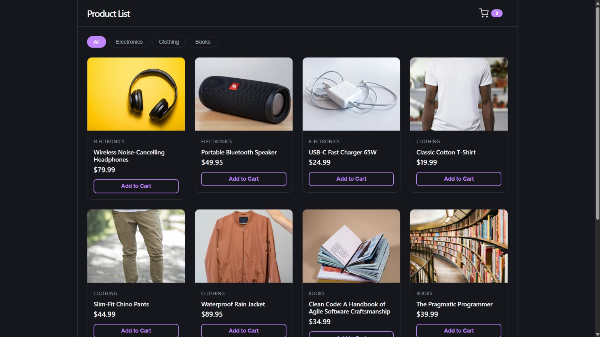
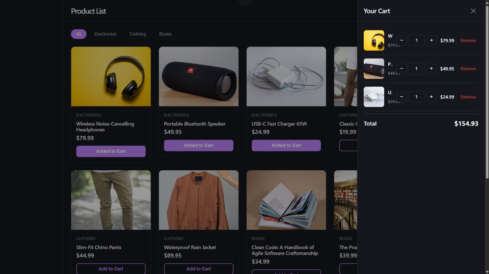
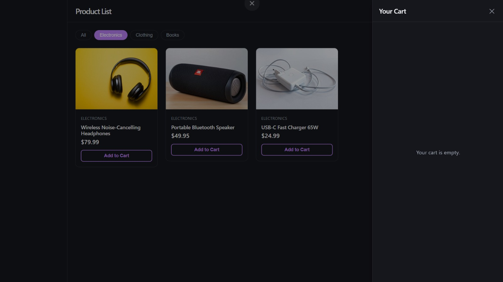

# Product List & Shopping Cart

A React + TypeScript + Vite web app for browsing products, filtering by category, adding items to a cart, managing quantities, and viewing a running total.

## Screenshots

### Landing Page


### Cart with Items


### Empty Cart


## Features

- **Product Listing** — Browse 9 products across 3 categories (Electronics, Clothing, Books)
- **Category Filter** — Filter products by category with an "All" option
- **Add to Cart** — One-click add from product cards; repeated clicks increment quantity
- **Cart Panel** — Slide-out side panel with overlay backdrop
- **Quantity Control** — Increment, decrement, or type a custom quantity (1–999)
- **Remove Items** — Remove any item from the cart regardless of quantity
- **Cart Summary** — Running total in USD, recalculates on every change
- **Responsive** — Multi-column grid on desktop, single column on mobile
- **Accessible** — Keyboard navigation, ARIA labels, focus indicators, focus trap in cart panel

## Tech Stack

- React 19 + TypeScript
- Vite
- Vitest + React Testing Library + Fast-check
- CSS (no external UI framework)

## Getting Started

```bash
npm install
npm run dev
```

Open `http://localhost:5173` in your browser.

## Build

```bash
npm run build
```

Output goes to `dist/`.

## Test

```bash
npm run test
```

## Project Structure

```
src/
├── components/
│   ├── CartBadge.tsx
│   ├── CartItemRow.tsx
│   ├── CartPanel.tsx
│   ├── CartSummary.tsx
│   ├── CategoryFilter.tsx
│   ├── Header.tsx
│   ├── ProductCard.tsx
│   ├── ProductGrid.tsx
│   ├── ProductPanel.tsx
│   └── QuantityControl.tsx
├── store/
│   ├── CartContext.tsx
│   ├── cartReducer.ts
│   └── useCart.ts
├── data/
│   └── products.ts
├── types/
│   └── index.ts
├── App.tsx
├── main.tsx
└── index.css
```
